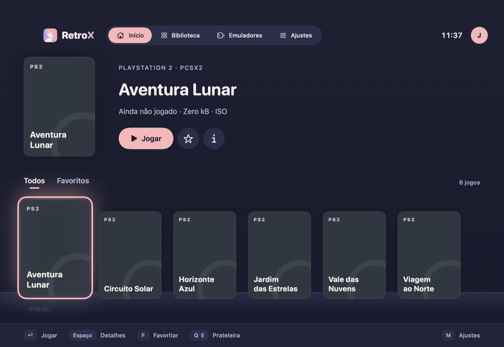
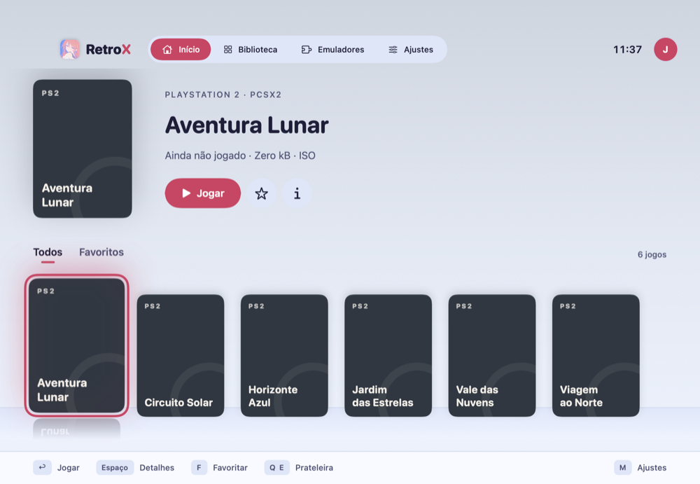
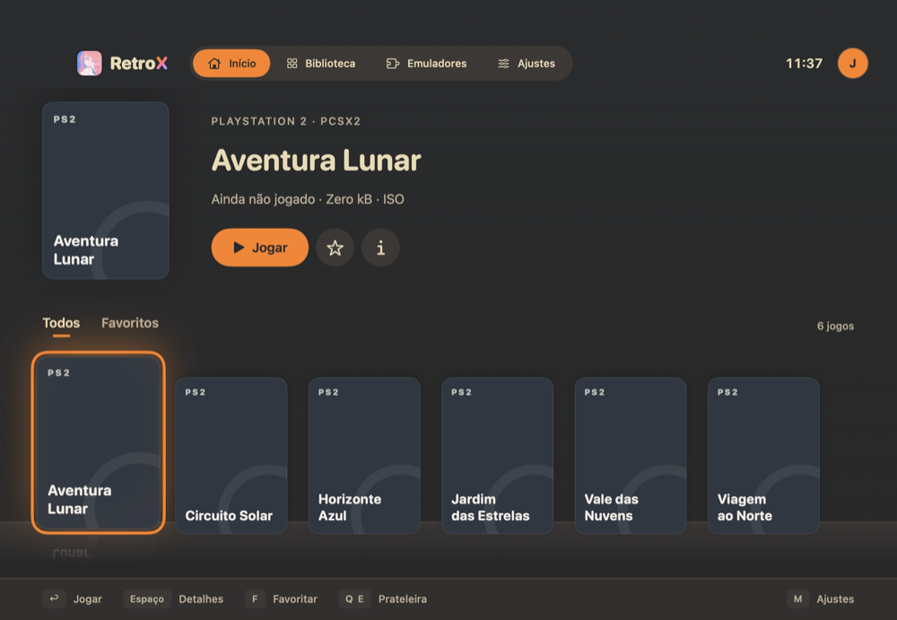
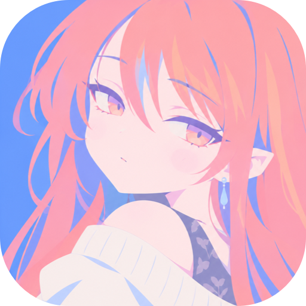

<div align="center">
  
  
  <p>Seus jogos, seus emuladores, uma só biblioteca.</p>
</div>

<div align="center">
  <a href="https://www.swift.org/"></a>
  <a href="https://www.apple.com/macos/"></a>
</div>

<div align="center">
  <a href="https://github.com/oLuqueJs/RetroX/actions/workflows/tests.yml"></a>
  <a href="https://github.com/oLuqueJs/RetroX/releases"></a>
  <a href="./LICENSE"></a>
</div>

<div align="center">
  <a href="https://github.com/oLuqueJs/RetroX/commits/main/"></a>
  <a href="https://github.com/oLuqueJs/RetroX/stargazers"></a>
</div>

<p align="center">
  <a href="#instalação">Instalação</a> ·
  <a href="#como-usar">Como usar</a> ·
  <a href="#desenvolvimento">Desenvolvimento</a> ·
  <a href="#documentação">Documentação</a>
</p>

---

RetroX é um launcher nativo para macOS que reúne seus jogos em uma biblioteca visual e os abre nos emuladores que você já tem instalados. Navegue pelo teclado ou controle, personalize perfis e temas, e volte à biblioteca quando terminar de jogar.

O RetroX não inclui emuladores, jogos, BIOS ou chaves. Ele lê suas pastas de jogos sem copiar, mover ou alterar os arquivos.

<p align="center">
  
  <br />
  <sub>Tela inicial com uma biblioteca de demonstração.</sub>
</p>

## Destaques

- **Biblioteca visual:** navegue por prateleira, carrossel, grade ou lista e encontre seus jogos por busca e console.
- **Perfis pessoais:** cada pessoa mantém seus próprios favoritos, recentes e preferências.
- **Feito para controle:** percorra o aplicativo pelo controle ou teclado, com glifos para Xbox, PlayStation e Switch.
- **Temas para escolher:** personalize cores, fonte e animações com variantes claras e escuras.
- **Seus emuladores:** configure o PCSX2, abra o jogo e volte ao RetroX ao terminar.

### Temas para o seu jeito de jogar

| Rayo Paradise · claro | Gruvbox · escuro |
| :---: | :---: |
|  |  |

## Instalação

### macOS (Apple Silicon)

**[Baixar a última versão](https://github.com/oLuqueJs/RetroX/releases/latest)**

Você precisa do macOS 14 ou superior e dos emuladores instalados por você. Hoje o RetroX suporta o **PCSX2** (PS2); o Dolphin (GameCube/Wii) está planejado.

1. Baixe `RetroX-<versão>.zip` na [página de Releases](https://github.com/oLuqueJs/RetroX/releases) e confira o `SHA256SUMS.txt`.
2. Descompacte e mova o `RetroX.app` para `/Applications`.
3. Na primeira vez, abra com o botão direito > **Abrir**. O app tem assinatura ad hoc e não é notarizado, então o Gatekeeper pede autorização.

## Como usar

1. Escolha (ou crie) um perfil em **Quem vai jogar?**. Cada perfil tem foto, tema, favoritos e recentes próprios.
2. Vá em **Emuladores**, ative o **PCSX2** e escolha a pasta dele: a que tem o `PCSX2.app` e as pastas de jogos (por exemplo `~/Emulators/ps2`, com `roms/` e `covers/`). O RetroX também usa as pastas de jogos, as capas (inclusive as que o PCSX2 baixa) e a BIOS que o próprio PCSX2 já conhece.
3. Em **Início**, navegue pela prateleira; em **Biblioteca**, veja todos os jogos em grade ou lista, com busca e filtro por console. Pressione **Return** (ou o botão de confirmar) para jogar. Quando o PCSX2 fecha, o RetroX volta para a frente.
4. Em **Detalhes**, troque a capa de um jogo ou busque informações na Wikipedia.
5. Em **Ajustes**, escolha tema, fonte, visualização da tela inicial (Prateleira, Carrossel ou Grade), animações e o tipo de controle. Cada perfil guarda os seus.

### Controles

| Ação | Teclado | Controle |
| --- | --- | --- |
| Navegar | Setas | Direcional ou analógico |
| Confirmar ou jogar | Enter | Botão de confirmar¹ |
| Voltar | Esc | Botão de voltar |
| Trocar de aba | `[` / `]` ou ⌘1–⌘4 | Gatilhos |
| Trocar prateleira ou console | Q / E | Botões superiores |
| Abrir detalhes | Espaço | Botão de detalhes |
| Favoritar | F | Botão de favorito |
| Buscar na biblioteca | `/` | — |
| Abrir ajustes | M ou ⌘, | Start |

¹ Por padrão, o botão inferior confirma; no layout Nintendo, é o botão da direita. Em **Ajustes > Controle**, escolha os glifos de Xbox, PlayStation (DualSense) ou Switch.

## Desenvolvimento

Para compilar: Swift 6, com as Command Line Tools ou o Xcode. A persistência das próximas fases vai exigir o Xcode.

```sh
scripts/check-toolchain.sh        # o que o toolchain atual consegue (Xcode, SwiftData, Rosetta)
swift build                       # app, ferramentas e núcleo
scripts/bundle-app.sh debug       # monta .build/RetroX.app (assinatura ad hoc)
open .build/RetroX.app
```

### Testes

```sh
scripts/test.sh                   # testes unitários (Swift Testing)
scripts/integration-launch.sh --process-only # processo falso sem janela (também no CI)
scripts/integration-launch.sh     # abre um emulador falso de verdade e confere o argv
RX_NETWORK=1 scripts/test.sh --filter MetadataNetworkTests   # busca real na Wikipedia (opt-in)
```

Veja [a estratégia de testes](docs/TESTING.md) para mocks, validação do pacote e
inspeções opcionais de instalações de PCSX2, Azahar e Ryujinx.

### Diagnóstico de launch

Sem a interface, com o mesmo código do app:

```sh
swift run rx-launch-probe --app /Applications/PCSX2.app --rom "/caminho/do/jogo.iso" --dry-run
```

Sem `--dry-run`, o emulador é aberto de verdade.

### Marca

O ícone, o tile e as assinaturas são gerados a partir de `docs/design/rayo/rayo.png`:

```sh
swift scripts/brand-kit.swift
```

### Releases

O workflow de testes do GitHub Actions roda em pull requests, em pushes para branches fora de `main` e em execuções manuais. O workflow de release reutiliza esses testes no commit enviado a `main`. Depois deles, o semantic-release analisa os commits convencionais, cria a tag e publica uma GitHub Release quando há mudanças que justificam uma nova versão, com o ZIP do `RetroX.app` para Apple Silicon e o SHA-256 anexados. A primeira versão automática será `1.0.0`.

Para gerar o pacote localmente, execute `scripts/package-app.sh 1.2.3`. O arquivo vai para `dist/`, para a arquitetura do computador, com assinatura ad hoc. Cada execução do workflow também deixa um pacote de teste (versão `0.0.0`) em **Artifacts**. Não é preciso conta Apple: não há notarização, e o macOS pode pedir autorização para abrir o app.

## Detalhes de implementação

O RetroX é escrito em Swift 6 (concorrência estrita) com SwiftUI e AppKit, e inclui:

* Núcleo (`RetroXCore`) sem interface, testável só com as Command Line Tools
* Emuladores como plugins, com detecção do app, das pastas de jogos, das capas e da BIOS
* Launch pelo LaunchServices com argumentos em array, sem shell, e retorno automático quando o emulador fecha
* Biblioteca não destrutiva: lê as pastas de jogos e nunca escreve nelas
* Metadados offline primeiro, com busca opcional na Wikipedia
* Navegação completa por teclado e controle (GameController), com glifos por tipo de controle
* 12 temas com variante clara e escura, entre eles o Rayo Paradise, com contraste conferido por testes

## Estrutura do projeto

* `Sources/RetroXCore/`: domínio, plugins de emulador, launch, biblioteca, perfis, metadados e temas
* `Sources/RetroXApp/`: o app em SwiftUI (telas, sistema de design, entrada por controle) e os recursos da marca
* `Sources/RXLaunchProbe/`: CLI de diagnóstico de launch
* `Sources/RXFakeEmulator/`: emulador falso usado nos testes de integração
* `Tests/RetroXCoreTests/`: testes unitários e de integração
* `Support/`: `Info.plist` e ícone do app
* `scripts/`: build, testes, empacotamento e geração da marca
* `docs/`: produto, ADRs, decisões, spikes e design

## Documentação

- [PRD](docs/PRD.md) — produto, escopo e critérios de aceite
- [Decisões de arquitetura](docs/adr/) — interface, plugins, lançamento e metadados
- [Decisões e pendências](docs/DECISOES.md) — escolhas e próximos passos
- [Estratégia de testes](docs/TESTING.md) — mocks, integração e emuladores
- [Spikes](docs/spikes/) — evidências com emuladores reais
- [Design](docs/design/brand-spec.md) e [kit da marca](docs/design/logo/README.md) — identidade e componentes
- [Origem](docs/origem/) — especificação original do projeto

<p align="center">
  
  <br />
  <sub>Conheça a Rayo no <a href="docs/design/logo/README.md">kit da marca</a>.</sub>
</p>

## Licença

Copyright © 2026 Otávio Luque ([yukaritake@proton.me](mailto:yukaritake@proton.me)).

Este projeto é licenciado sob a GNU General Public License v3.0. Veja [LICENSE](LICENSE) para os detalhes.

Mesmo com a licença GPL, fique à vontade para entrar em contato se quiser usar o RetroX num projeto proprietário. Estou aberto a combinar licenças alternativas caso a caso.

PCSX2, Dolphin e os nomes de consoles citados pertencem aos seus respectivos donos. O RetroX não é afiliado a eles, e ilustrações, logos e telas de terceiros citados como inspiração não são usados no projeto.
