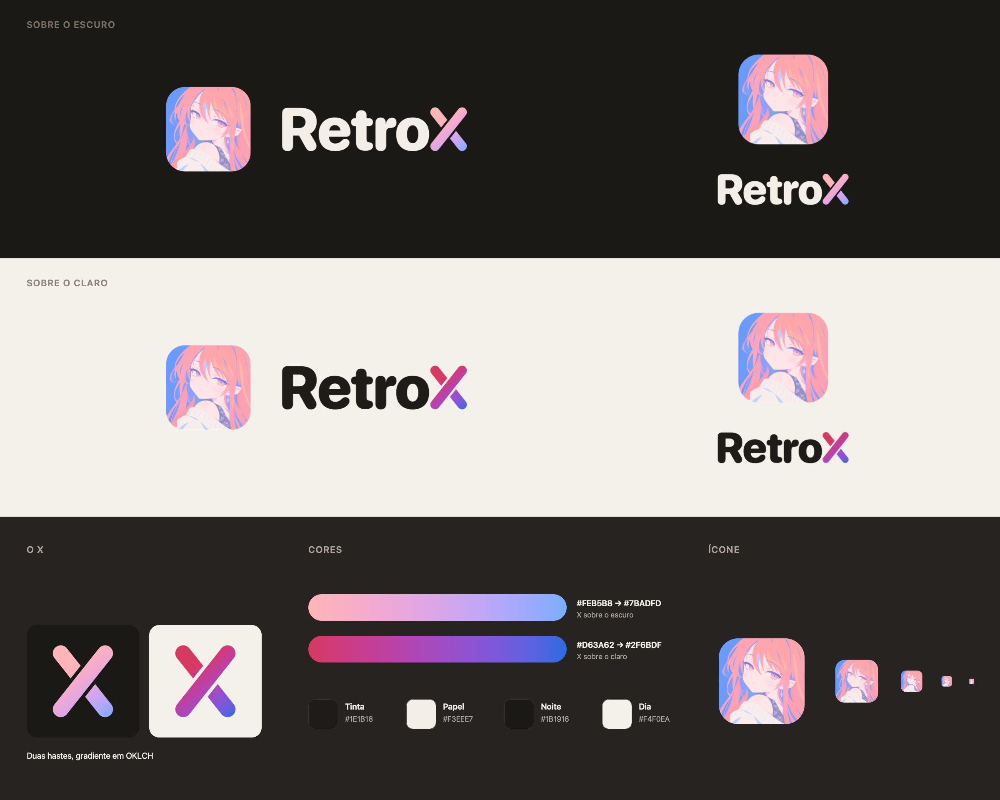

# Kit da marca RetroX

A marca é a **Rayo** (o tile) e o nome **RetroX**, com o "X" feito de duas hastes em gradiente. Tudo aqui é gerado a partir de
`docs/design/rayo/rayo.png` por `swift scripts/brand-kit.swift`; para mudar o kit, mude o original ou o script,
nunca os PNGs à mão.



## Arquivos

| Arquivo | Uso |
|---|---|
| `retrox-icon-1024.png` | Ícone na grade do macOS (corpo 824/1024, cantos transparentes). O `.icns` fica em `Support/RetroX.icns` |
| `retrox-tile-512.png` | Só o tile, sem margem: avatares, favicons, redes |
| `retrox-lockup-on-dark.png` / `-on-light.png` | Assinatura horizontal (padrão; barra superior e abertura do app) |
| `retrox-stacked-on-dark.png` / `-on-light.png` | Assinatura empilhada: espaços estreitos e verticais (README, redes) |
| `retrox-wordmark-on-dark.png` / `-on-light.png` | Só o nome, quando a Rayo já está por perto |
| `retrox-x-on-dark.png` / `-on-light.png` | Só o X: detalhes, carregamento, selos |

## Alinhamento

Toda medida vem da **altura das maiúsculas (C)** do nome, em SF Pro Rounded Heavy com tracking −1,5%.

- **Horizontal:** tile = 2C. A faixa das maiúsculas (da linha de base ao topo do "R") fica centrada no tile. O vão
  entre o tile e a tinta do "R" é 0,75C.
- **Empilhada:** tile = 3C, centrado sobre o nome. Do pé do tile ao topo das maiúsculas: 1C.
- **"o→X":** o X tem recuo lateral largo, então o par leva um aperto extra de −4,5% do corpo. Assim todos os vãos
  entre as letras ficam iguais.
- **O X:** duas hastes em cápsula, na caixa e na espessura do X da fonte. A haste "/" passa por cima da "\\", com
  um vão de 7% do corpo em volta dela. O X é construído, e não a letra da fonte, porque as hastes da fonte afinam
  no cruzamento.
- **Gradiente do X:** do canto de cima à esquerda ao de baixo à direita, igual nas duas hastes. A cor inicial
  segura até 30% e então caminha até a final, misturada em OKLCH (o meio fica vivo, sem o cinza da mistura em RGB).
- **Respiro:** no mínimo 1C livre em volta da assinatura.
- **Tamanho mínimo:** horizontal com nome a partir de 16 pt; abaixo disso, só o tile.

No app, `BrandLockup`, `BrandWordmark` e `BrandMark` (`Sources/RetroXApp/DesignSystem/Brand.swift`) aplicam as
mesmas regras de alinhamento.

## Cores

| Nome | Hex | Uso |
|---|---|---|
| Rosa Rayo → Céu Rayo | `#FEB5B8` → `#7BADFD` | Gradiente do X sobre o escuro (≥ 7,7:1 sobre `#1B1916`) |
| Framboesa → Azul elétrico | `#D63A62` → `#2F6BDF` | Gradiente do X sobre o claro (pior ponto 3,99:1 sobre `#F4F0EA`) |
| Tinta / Papel | `#1E1B18` / `#F3EEE7` | "Retro" sobre o claro / sobre o escuro |
| Noite / Dia | `#1B1916` / `#F4F0EA` | Fundos de referência |

## Não fazer

- Não recortar, girar nem trocar a ilustração do tile; não pôr a Rayo em círculo (vira foto de perfil).
- Não colorir o "Retro", não pintar o X de uma cor só nem trocar a direção do gradiente.
- Não usar o gradiente do escuro sobre fundo claro (some) nem o do claro sobre o escuro.
- Não aproximar o tile do nome além de 0,75C, nem centralizar o nome pela caixa do texto (fica baixo).

## Cabeçalho para o README do projeto

```html
<p align="center">
  <picture>
    <source media="(prefers-color-scheme: dark)" srcset="docs/design/logo/retrox-lockup-on-dark.png">
    
  </picture>
</p>
<p align="center">Seus jogos, num lugar só. Um launcher nativo para macOS.</p>
```
